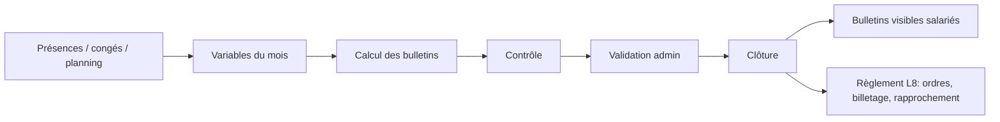

Inventaire en lecture seule de `C:\IT-Mozaic\SOMA-RH-local` (aucune donnée personnelle copiée).

## Périmètre actuel

| Domaine | Couvert aujourd'hui | Preuve |
|---|---|---|
| Socle RH | Salariés, dossiers administratifs, documents privés (aperçus, archive Word), organigramme, équipes et managers | pages `salaries`, `dossiers-salaries`, `equipes`; migrations `core_hr`, `organigramme`, `phase3_private_documents` |
| Temps | Congés à deux niveaux avec délégation, planning des postes, présences synchronisées vers la paie | migrations `l6_conges_deux_niveaux`, `lot5_planning_postes`, `lot3_presences` |
| Paie | Moteur `compute_salary_slip`, variables, prêts et régularisations, traitements, gouvernance (contrôle, clôture, réouverture, séparation des tâches), simulateur net/brut, bulletin expliqué | migrations `payroll_*`, `l1_gouvernance_complete`, `l2_ajustements_paie` |
| Règlement | Billetage, ordres, rapprochement (L8), suivi des paiements | migrations `l8_reglement`, `lot3_suivi_paiements` |
| États | États de paie, états et déclarations (exports) | migrations `reports`, `etat_paye` |
| Self-service | Mon espace, demandes, Mes bulletins, notifications internes | `phase3_employee_request_workflow`, `phase3_request_notifications` |
| Pilotage | Tableau de bord, Pilotage RH, prévision de masse salariale | `lot6_pilotage_rh` |
| Sécurité | RLS par rôle (admin, rh, paie, manager, salarié), journal d'audit chaîné, garde de transition de paie | `security_rls`, `audit_unique_chaine`, `payroll_validation_guard` |

## Workflow mensuel actuel

## Constats de sécurité (API `api/server.mjs`)

<Warning>
Ces points relèvent du code local ; à traiter avant toute exposition hors poste de développement.
</Warning>

1. `POST /auth/v1/signup` est ouvert sans authentification et confirme l'e-mail automatiquement.
2. Le `refresh_token` est un second JWT identique au jeton d'accès (8 h) : pas de rotation ni de révocation ; `logout` renvoie 204 sans invalider.
3. Aucune limitation de débit, aucun verrouillage de compte, aucune authentification multifacteur, aucun SSO.
4. Aucun envoi réel d'e-mail ou de SMS : les notifications existent seulement en base.
5. CORS limité à `localhost:5173` (correct en développement, à rendre configurable).

## Manques fonctionnels constatés

Une recherche dans `db/`, `api/` et `web/src/pages` ne trouve aucune trace de : export d'OD de paie vers la comptabilité, fichier de virement bancaire, Mobile Money, télédéclaration NDAMLI/DGID, pointeuse biométrique, recrutement, formation, évaluation, notes de frais, solde de tout compte/sortie. Les recherches sur recrutement/formation/évaluation sont à refaire par lecture des tables (`\dt`) car la requête automatique a été interrompue.

<Note>
`docs/ANALYSE_SAGE_PAIE_RH_VS_SOMA_RH.md` et `GAP_ANALYSIS_NEXTGEN_SOMA_RH.md` existaient déjà : ce comparatif les complète (concurrents supplémentaires, intégrations, sécurité) sans les remplacer.
</Note>
