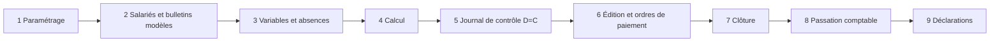

## Paie mensuelle (référence Sage, 9 étapes)

Sources du notebook : formations Sage Paie & RH (module 1, paramétrage, rubriques et constantes, leçon 3, passation comptable).

Écarts SOMA-RH : étapes 5 (équilibre comptable), 8 et 9 absentes ; étape 6 partielle (règlement L8 sans fichier bancaire).

## Sortie et solde de tout compte

Saisie du motif et du préavis → liquidation (congés non pris, précarité CDD, préavis, licenciement) → reçu de solde et certificat de travail → retrait des accès et archivage. **Absent de SOMA-RH.** Montants légaux à valider au Code du travail (voir [sources](/comparatif/sources)).

## Embauche

Besoin → candidature → dossier (pièces) → contrat → immatriculation IPRES/CSS → bulletin modèle et compte. SOMA-RH couvre dossier et compte ; recrutement et immatriculation sont à ajouter.

## Congés

Demande → contrôle des droits → validation N+1 puis RH (délégation) → impact planning et paie. **Couvert** (L6).
